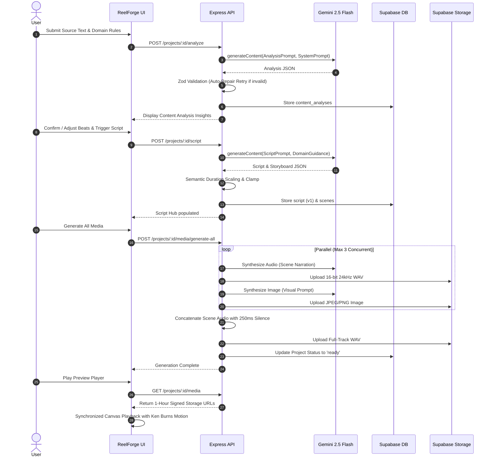

# ReelForge AI — Multimodal Text-to-Video Content Studio

> **Transform single-modal text knowledge (blogs, articles, documents, notes, URLs) into production-ready multimodal short-video packages with AI-generated scripts, scene storyboards, synthesized voiceovers, and synchronized in-browser playback.**

---

## 1. Product Overview

Audiences consume knowledge predominantly through video and audio, yet immense amounts of valuable information remain trapped in static text. Content creators, marketers, and educators currently jump across fragmented tools—script generators, text-to-speech services, image generators, and timeline editors—wasting hours per clip.

**ReelForge AI** eliminates this friction. By submitting raw text, uploading documents (`.pdf`, `.docx`, `.txt`, `.md`), or pasting a web URL, creators obtain a complete, customizable multimodal short-video package in under 3 minutes:
1. **AI Content Analysis**: Strategic summary, key takeaway bullets, topic categorization, audience resonance analysis, and recommended pacing.
2. **Video Configuration**: Precision targeting across 9 specialized domains, social platforms (YouTube Shorts, TikTok, Instagram Reels, LinkedIn), tones, target durations, and visual aesthetic styles.
3. **Structured Script & Storyboard**: Hook, scene-by-scene narration, on-screen text, visual descriptions, image prompts, camera motion, and transitions.
4. **Multimodal Audio & Visual Assets**: High-fidelity scene voiceovers and seamless full-track audio via Gemini Speech TTS, alongside cinematic scene storyboard imagery via Gemini Image Generation.
5. **Synchronized In-Browser Preview**: Real-time canvas/HTML player playing scene imagery with Ken Burns panning motion, voiceover audio, and burned-in captions in complete sync.
6. **Multi-Format Export Center**: Script JSON, SRT/VTT subtitles, full-track 24kHz WAV, ZIP image bundles with prompts, and print-ready A4 landscape PDF storyboards.

---

## 2. System Architecture

```mermaid
flowchart TD
    subgraph Client["React Client (Vite + TypeScript + Tailwind)"]
        UI[App UI: Auth / Ingestion / Editor / Studio / Preview / Dashboard]
        Player[Synchronized Preview Player\n(Ken Burns Motion + Web Audio Clock)]
        RQ[TanStack Query Cache + State]
    end

    subgraph Server["Express API Server (Node.js 20+ TypeScript)"]
        MW[Auth Middleware + Rate Limiters + Zod Validator + Error Handler]
        Routers[Modular Routers: /sources, /projects, /scenes, /exports, /me]
        SSRF[SSRF Protection Layer & DNS Resolution Guard]
        WAVEngine[PCM-to-WAV Audio Engine & Concat Pipeline]
    end

    subgraph Supabase["Supabase Cloud Platform"]
        Auth[Supabase Auth (JWT)]
        DB[(PostgreSQL with Row Level Security - RLS)]
        Storage[(Supabase Storage: project-audio & project-images)]
    end

    subgraph Gemini["Google Gemini Generative AI"]
        GeminiText[Gemini 2.5 Flash\n(Structured JSON & Analysis)]
        GeminiTTS[Gemini Speech Generation\n(Multimodal TTS Engine)]
        GeminiImg[Gemini Image Generation\n(Imagen / Flash Vision)]
    end

    UI -->|JWT Auth & REST API| MW
    MW --> Routers
    Routers --> SSRF
    Routers --> WAVEngine
    Routers -->|JWT-Scoped Client| DB
    Routers -->|Storage Admin| Storage
    Routers -->|Server-Only API Key| Gemini
    Player -->|Signed Storage URLs 1h TTL| Storage
    Client -->|User Auth| Auth
```

---

## 3. Technology Stack & Rationale

| Layer | Technology | Rationale |
| :--- | :--- | :--- |
| **Monorepo** | NPM Workspaces (`shared`, `server`, `client`) | Strict single source of truth for TypeScript types and Zod schemas across frontend and backend. |
| **Frontend** | React 18+, Vite, TypeScript, Tailwind CSS | Sub-second HMR, type-safe development, lightweight production bundles, modern glassmorphic responsive UI. |
| **State & Data** | TanStack Query v5, React Router v6 | Optimistic updates, background re-fetching, cache invalidation, and declarative route authentication. |
| **Forms & Validation** | React Hook Form + `@hookform/resolvers/zod` | Declarative, accessible form handling with zero runtime re-render lag and shared validation rules. |
| **Backend** | Node.js 20+, Express.js (TypeScript) | Non-blocking I/O for media processing, modular routing, standardized error handling, and robust middleware ecosystem. |
| **Database & Auth** | Supabase PostgreSQL + Supabase Auth | Built-in JWT authentication, Row Level Security (RLS) enforcement at database layer, and managed ACID transactions. |
| **Cloud Storage** | Supabase Storage (Private Buckets) | Secure multi-tenant asset isolation, signed URLs with 1-hour expiration time (no public bucket exposure). |
| **AI Models** | `@google/genai` (Server-Only SDK) | Google Gemini 2.5 Flash for structured JSON extraction & scripts; multimodal speech generation for TTS; image synthesis. |
| **Security** | Helmet, CORS, Rate Limiters, SSRF Defense | Defense-in-depth: DNS pre-flight checks, private IP blocking, 1MB payload limits, strict CSP, and JWT token scoping. |
| **Audio Processing** | Custom 16-bit 24kHz PCM-to-WAV buffer engine | Server-side conversion and concatenation with 250ms silence intervals between scenes without external heavy binaries. |
| **Testing** | Vitest, Supertest | Fast ESM-native test runner, multi-tenant isolation verification, mock Supabase & Gemini sandboxing. |

---

## 4. Repository Structure

```
reelforge-ai/
├── package.json                 # Monorepo root workspace configuration
├── package-lock.json
├── shared/                      # @reelforge/shared: Isomorphic schemas and constants
│   ├── package.json
│   ├── tsconfig.json
│   └── src/
│       ├── index.ts             # Domain constants, platforms, Zod schemas, types
│       └── index.test.ts        # Unit tests for shared validation logic
├── server/                      # @reelforge/server: Express REST API
│   ├── package.json
│   ├── tsconfig.json
│   ├── .env.example
│   └── src/
│       ├── app.ts               # Express application initialization & middleware
│       ├── index.ts             # Server entry point (port listening)
│       ├── config/env.ts        # Zod environment variable parsing
│       ├── ai/                  # AI Prompts, Domain Guidance, System Prompts, Semantic Checks
│       ├── lib/                 # Gemini SDK, Supabase clients, SSRF guard, WAV encoder, Logger
│       ├── middleware/          # JWT Auth, Central Error Handler, Rate Limiters, AI Quota, Zod Validator
│       ├── routes/              # /me, /sources, /projects, /scenes, /media, /exports
│       ├── services/            # SourceService, ProjectService, AnalysisService, ScriptService, MediaService, ExportService
│       └── tests/               # Health, Auth, Source, AI semantic checks, and Data Isolation tests
├── client/                      # @reelforge/client: Vite React Single Page Application
│   ├── package.json
│   ├── tsconfig.json
│   ├── vite.config.ts
│   ├── index.html
│   ├── .env.example
│   └── src/
│       ├── main.tsx             # React DOM entry point
│       ├── App.tsx              # React Router v6 tree with ProtectedRoute
│       ├── lib/                 # Supabase client, typed API fetch client
│       ├── context/AuthContext  # AuthProvider for session persistence and login/logout
│       ├── components/          # Layout, Navbar, ProtectedRoute, Canvas Player, Modals
│       └── pages/               # Landing, Login, Signup, Forgot/Reset Password, Dashboard, NewProject, ProjectHub, Editor, Media, Preview, Export, Settings
└── supabase/
    └── migrations/
        ├── 0001_init.sql        # Database schema, triggers, indexes, and storage buckets
        └── 0002_rls.sql         # Row Level Security (RLS) policies for multi-tenancy
```

---

## 5. Prerequisites & Environment Setup

### Prerequisites
- **Node.js**: v20.x or higher
- **npm**: v10.x or higher
- **Supabase Account**: A PostgreSQL project with Auth and Storage enabled
- **Google Gemini API Key**: Access to Gemini 2.5 Flash, speech synthesis, and image generation

### 1. Clone & Install Dependencies
```bash
git clone <repository-url>
cd reelforge-ai
npm install
```

### 2. Environment Variables Configuration

#### Server Environment (`server/.env`)
Copy `server/.env.example` to `server/.env` and supply your credentials:
```bash
cp server/.env.example server/.env
```

| Variable | Description | Required | Example |
| :--- | :--- | :--- | :--- |
| `PORT` | API server listen port | No (default `3001`) | `3001` |
| `NODE_ENV` | Runtime environment | No (default `development`) | `development` |
| `CLIENT_ORIGIN` | Allowed client origin for CORS | Yes | `http://localhost:5173` |
| `SUPABASE_URL` | Supabase project API URL | Yes | `https://xyzcompany.supabase.co` |
| `SUPABASE_ANON_KEY` | Supabase anonymous public key | Yes | `eyJhbGciOi...` |
| `SUPABASE_SERVICE_ROLE_KEY` | Supabase service-role secret (server-only) | Yes | `eyJhbGciOi...` |
| `GEMINI_API_KEY` | Google Gemini API secret (server-only) | Yes | `AIzaSy...` |
| `GEMINI_TEXT_MODEL` | Gemini model for analysis & scripts | No | `gemini-2.5-flash` |
| `GEMINI_TTS_MODEL` | Gemini model for speech synthesis | No | `gemini-2.5-flash` |
| `GEMINI_IMAGE_MODEL` | Gemini model for image generation | No | `imagen-3.0-generate-002` |
| `DAILY_AI_QUOTA_PER_USER` | Maximum daily AI calls per user | No (default `50`) | `50` |
| `SIGNED_URL_TTL_SECONDS` | Lifetime for signed media URLs | No (default `3600`) | `3600` |

> [!CAUTION]
> `GEMINI_API_KEY` and `SUPABASE_SERVICE_ROLE_KEY` must **never** be shared with the client or committed to version control. They are strictly validated on the server using Zod.

#### Client Environment (`client/.env`)
Copy `client/.env.example` to `client/.env`:
```bash
cp client/.env.example client/.env
```

| Variable | Description | Required | Example |
| :--- | :--- | :--- | :--- |
| `VITE_SUPABASE_URL` | Supabase project API URL | Yes | `https://xyzcompany.supabase.co` |
| `VITE_SUPABASE_ANON_KEY` | Supabase anonymous public key | Yes | `eyJhbGciOi...` |
| `VITE_API_URL` | Backend Express API base URL | Yes | `http://localhost:3001/api/v1` |

---

## 6. Database Setup & Migrations

The database migrations establish all 8 relational tables, automatic timestamps, indexes, foreign key cascades, storage buckets, and PostgreSQL Row Level Security (RLS) policies.

### Option A: Using the Supabase CLI
```bash
supabase login
supabase link --project-ref <your-project-ref>
supabase db push
```

### Option B: Using psql / Supabase SQL Editor
Execute the migration scripts in sequential order:
1. `supabase/migrations/0001_init.sql` (Creates tables, extensions, triggers, indexes, and storage buckets)
2. `supabase/migrations/0002_rls.sql` (Enables Row Level Security on all tables and storage objects)

```bash
psql -h db.<your-project-ref>.supabase.co -U postgres -d postgres -f supabase/migrations/0001_init.sql
psql -h db.<your-project-ref>.supabase.co -U postgres -d postgres -f supabase/migrations/0002_rls.sql
```

---

## 7. Running the Application

### Development Mode (Concurrent Frontend & Backend)
From the root directory:
```bash
npm run dev
```
- Client runs at: `http://localhost:5173`
- Server API runs at: `http://localhost:3001`
- Health check endpoint: `http://localhost:3001/api/v1/health`

### Building for Production
```bash
npm run build
```
This builds `@reelforge/shared`, `@reelforge/server` (`tsc`), and `@reelforge/client` (`vite build`).

### Starting the Production Server
```bash
npm run start --workspace=server
```

---

## 8. Automated Testing & Verification

ReelForge AI includes a comprehensive test suite covering schema validation, source extraction, AI semantic constraints, auth middleware, and automated cross-user isolation.

### Run All Tests
```bash
npm test
```

### Run Tests Per Workspace
```bash
# Shared package tests
npm run test:shared

# Server integration & isolation tests
npm run test:server
```

### Multi-Tenancy Isolation Test
The isolation test suite (`server/src/tests/isolation.test.ts`) guarantees that **User B** cannot access, mutate, delete, or trigger AI operations on **User A's** data:
- `GET /api/v1/projects/:id` -> `404 NOT_FOUND`
- `PATCH /api/v1/projects/:id` -> `404 NOT_FOUND`
- `DELETE /api/v1/projects/:id` -> `404 NOT_FOUND`
- `PATCH /api/v1/scenes/:id` -> `404 NOT_FOUND`
- `DELETE /api/v1/scenes/:id` -> `404 NOT_FOUND`
- `GET /api/v1/projects/:id/media` -> `404 NOT_FOUND`
- `POST /api/v1/projects/:id/analyze` -> `404 NOT_FOUND`
- `POST /api/v1/projects/:id/script` -> `404 NOT_FOUND`
- `POST /api/v1/projects/:id/media/generate-all` -> `404 NOT_FOUND`
- `POST /api/v1/scenes/:id/audio` -> `404 NOT_FOUND`
- `POST /api/v1/scenes/:id/image` -> `404 NOT_FOUND`
- `POST /api/v1/scenes/:id/regenerate` -> `404 NOT_FOUND`
- `GET /api/v1/projects/:id/export/json` -> `404 NOT_FOUND`
- `GET /api/v1/projects/:id/export/srt` -> `404 NOT_FOUND`

---

## 9. API Reference

All protected endpoints require an `Authorization: Bearer <token>` header obtained from Supabase Auth.

| Method | Path | Description | Rate Limit |
| :--- | :--- | :--- | :--- |
| `GET` | `/api/v1/health` | Service health status and configured models | 120 / min |
| `GET` | `/api/v1/me` | Fetch current user profile | 60 / min |
| `PATCH` | `/api/v1/me` | Update user full name / avatar URL | 30 / min |
| `POST` | `/api/v1/sources/extract-file` | Extract and normalize text from PDF/DOCX/TXT/MD | 20 / min |
| `POST` | `/api/v1/sources/fetch-url` | SSRF-protected webpage content scraper | 15 / min |
| `GET` | `/api/v1/projects` | List projects with search, domain, and status filters | 120 / min |
| `POST` | `/api/v1/projects` | Create a new project with source text and configuration | 30 / min |
| `GET` | `/api/v1/projects/:id` | Fetch full project graph with script, scenes, and assets | 120 / min |
| `PATCH` | `/api/v1/projects/:id` | Update project configuration or metadata | 60 / min |
| `POST` | `/api/v1/projects/:id/duplicate`| Clone project and its active script & scenes | 20 / min |
| `DELETE`| `/api/v1/projects/:id` | Cascading delete project, scenes, and cloud storage | 30 / hour |
| `POST` | `/api/v1/projects/:id/analyze` | AI Content Analysis (summary, topics, structure) | 20 / hour |
| `POST` | `/api/v1/projects/:id/script` | AI Script & Visual Storyboard Generation | 20 / hour |
| `GET` | `/api/v1/projects/:id/scripts` | List historical script versions | 120 / min |
| `POST` | `/api/v1/projects/:id/scripts/:scriptId/activate` | Restore historical script version | 30 / min |
| `POST` | `/api/v1/projects/:id/scenes` | Add scene at specific index with re-indexing | 60 / min |
| `POST` | `/api/v1/projects/:id/scenes/reorder` | Reorder scenes with temporary unique indexing | 60 / min |
| `PATCH` | `/api/v1/scenes/:sceneId` | Edit narration, on-screen text, prompts, or motion | 60 / min |
| `DELETE`| `/api/v1/scenes/:sceneId` | Delete scene and adjust subsequent scene indices | 60 / min |
| `POST` | `/api/v1/scenes/:sceneId/regenerate` | Context-aware AI regeneration of a single scene | 30 / hour |
| `POST` | `/api/v1/scenes/:sceneId/audio` | Synthesize TTS audio for a scene via Gemini | 30 / hour |
| `POST` | `/api/v1/scenes/:sceneId/image` | Synthesize storyboard image for a scene via Gemini | 30 / hour |
| `POST` | `/api/v1/projects/:id/media/generate-all` | Batch generate all missing audio and images | 10 / hour |
| `POST` | `/api/v1/projects/:id/audio/full-track` | Concatenate scene audio with 250ms silence | 30 / hour |
| `GET` | `/api/v1/projects/:id/media` | Generate 1-hour signed URLs for project media | 120 / min |
| `GET` | `/api/v1/projects/:id/export/json` | Export project, analysis, and script JSON package | 60 / min |
| `GET` | `/api/v1/projects/:id/export/srt` | Download SubRip (.srt) caption file | 60 / min |
| `GET` | `/api/v1/projects/:id/export/vtt` | Download WebVTT (.vtt) caption file | 60 / min |
| `GET` | `/api/v1/projects/:id/export/wav` | Download concatenated 24kHz full-track WAV | 20 / min |
| `GET` | `/api/v1/projects/:id/export/zip` | Download ZIP of storyboard images + prompts.txt | 20 / min |
| `GET` | `/api/v1/projects/:id/export/pdf` | Download printable A4 landscape storyboard PDF | 20 / min |

---

## 10. AI Generation Pipeline & Resilience



### Self-Healing AI Output Validation
Every Gemini response is verified against strict Zod schemas (`AnalysisOutputSchema`, `ScriptOutputSchema`, `SceneOutputSchema`). If validation fails:
1. The server logs the validation issue.
2. An automated repair loop sends the invalid JSON back to Gemini with error pointers to correct the structure.
3. If the retry fails, a clean `502 AI_GATEWAY_ERROR` is returned without application crash.
4. Scene durations are semantically scaled and clamped to enforce platform limits.

---

## 11. Evaluator Testing Guide

To verify ReelForge AI against the Master Prompt specifications:

1. **Authentication Flow**:
   - Navigate to `/signup`, register an account with email and password.
   - Verify immediate redirect to `/dashboard`. Sign out and log back in at `/login`.
2. **Ingestion & Domain Configuration**:
   - Click **New Project** (`/projects/new`).
   - Test **Paste Text** (with live character and word counters).
   - Test **Upload Document** (`.pdf`, `.docx`, `.txt`, `.md`).
   - Test **Fetch URL** (e.g. any public tech blog or news article; notice automatic SSRF protection).
   - Select a domain (e.g., **FinTech & Crypto** or **Healthcare & Wellness**). Observe advisory disclaimers and recommended tone adjustments.
   - Choose target duration (30s, 60s, or 90s) and target platform.
3. **AI Content Analysis & Script Generation**:
   - Click **Create Project & Analyze**.
   - Review the AI Strategic Analysis: summary, bullet points, topic, and beat structure.
   - Click **Generate Script & Storyboard**.
   - Verify hook, scene cards, durations, visual descriptions, image prompts, hashtags, and CTA.
4. **Scene Storyboard Editor**:
   - Navigate to the **Editor** tab.
   - Edit a scene narration; observe the live word count and pace indicator.
   - Click **Add Scene** to insert a scene at an index.
   - Click **Regenerate with AI** on an individual scene with specific instructions.
   - Inspect script version history and test activating an older version.
5. **Media Generation Studio**:
   - Navigate to the **Media** tab.
   - Click **Generate All Media** (or generate an individual scene's audio or image).
   - Listen to synthesized voiceover per scene; open image lightbox to inspect visual generation.
6. **Synchronized Preview Player**:
   - Navigate to the **Preview** tab.
   - Press **Play** (or tap `Spacebar`).
   - Verify scene images render with smooth Ken Burns panning motion.
   - Verify burned-in title overlay appears for the opening 2.5 seconds.
   - Verify caption chunks sync with scene voiceovers.
   - Test `0.75x`, `1.0x`, `1.25x`, and `1.5x` playback speeds.
7. **Export Center**:
   - Navigate to the **Export** tab.
   - Download Script JSON, SRT, VTT, Full-Track WAV, Images ZIP, and Storyboard PDF.
   - Open the generated PDF to confirm A4 landscape formatting with title page and per-scene details.
8. **Multi-Tenancy Verification**:
   - Log in with a second user account.
   - Attempt to access the first user's project URL: observe an immediate `404 NOT_FOUND` without leaking project existence.

---

## 12. License

This project is licensed under the MIT License.

